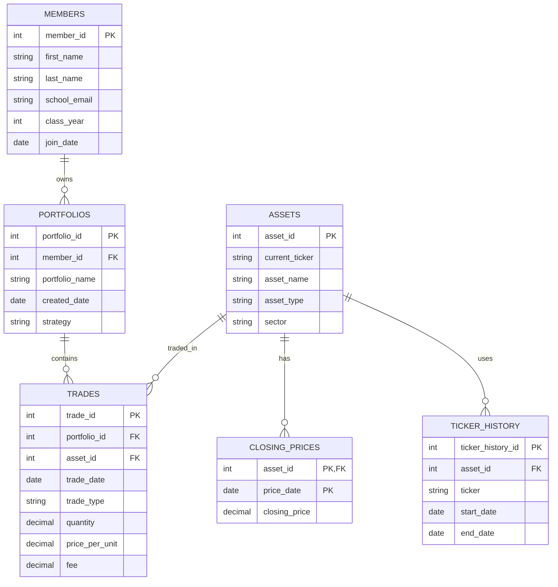

# The Scenario
Scenario B: Babson Investment Club
The Babson Investment Club runs simulated investment portfolios for its members. Currently, the club tracks its investments using spreadsheets and screenshots from a broker. The goal of this database is to organize information about members, portfolios, assets, trades, and closing prices so the club can track trading activity and calculate portfolio holdings and values.
# The ERD

# What One Row Means
MEMBERS: 
One row represents one singular student who is a member of the Babson Investment Club. 
PORTFOLIOS: 
One row represents a singular investment portfolio that belongs to a member of the club.
ASSETS:
One row represents one stock, ETF, or cryptocurrency that the investment club tracks. 
TRADES:
One row represents one transaction in a portfolio that buys or sells an asset. 
CLOSING PRICES:
One row represents the closing price of a particular asset on a particular date. 
TICKER HISTORY:
One row represents a ticker symbol used by an asset during a particular time. 
# Design Choices
1: Which key did you choose and why?
I chose to use an asset ID as the primary key because using an asset ID allows the database to track the same investment even if the ticker changes. 
2: Which relationships are optional?
A member of the club can have a wide range of portfolios so owning a portfolio is optional, people don't have to have one. An asset can also be in the database without any trades because the investment club could follow investments that it hasn't bought or sold. 
3. Which rules cannot be enforced by your tables?
A rule that can't be enforced by my tables with a check restraint is that a portfolio can't sell more shares of an asset than it currently has. This would mean having to look at previous transactions to figure out the number of shares available. 
4. What did you change or check in the AI generated design?
The first ERD had an asset table with a ticker symbol but didn't track historical ticker changes. I then added a ticker history table so that the database could record previous ticker symbols while also keeping the same asset ID. 